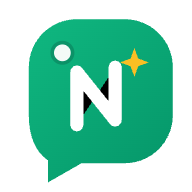

<!-- markdownlint-disable MD033 MD041 -->
<a id="readme-top"></a>

<!-- PROJECT SHIELDS -->
[![Contributors][contributors-shield]][contributors-url]
[![Forks][forks-shield]][forks-url]
[![Stargazers][stars-shield]][stars-url]
[![Issues][issues-shield]][issues-url]
[![MIT License][license-shield]][license-url]

<!-- PROJECT LOGO -->
<br />
<div align="center">
  <a href="https://negolah.my">
    
  </a>

  <h3 align="center">Nego-Lah</h3>

  <p align="center">
    An autonomous second-hand marketplace where a real-time AI agent negotiates prices, enforces server-side floor guardrails, and settles Stripe payments directly in chat.
    <br />
    <a href="docs/README.md"><strong>Explore the docs »</strong></a>
    <br />
    <br />
    <a href="https://negolah.my">Live Store</a>
    &middot;
    <a href="https://github.com/terryong31/nego-lah/issues/new?labels=bug">Report Bug</a>
    &middot;
    <a href="https://github.com/terryong31/nego-lah/issues/new?labels=enhancement">Request Feature</a>
  </p>
</div>

<!-- TABLE OF CONTENTS -->
<details>
  <summary>Table of Contents</summary>
  <ol>
    <li>
      <a href="#about-the-project">About The Project</a>
      <ul>
        <li><a href="#engineering-highlights">Engineering Highlights</a></li>
        <li><a href="#built-with">Built With</a></li>
      </ul>
    </li>
    <li>
      <a href="#getting-started">Getting Started</a>
      <ul>
        <li><a href="#prerequisites">Prerequisites</a></li>
        <li><a href="#installation">Installation</a></li>
      </ul>
    </li>
    <li><a href="#usage">Usage</a></li>
    <li><a href="#roadmap">Roadmap</a></li>
    <li><a href="#contributing">Contributing</a></li>
    <li><a href="#license">License</a></li>
    <li><a href="#contact">Contact</a></li>
    <li><a href="#acknowledgments">Acknowledgments</a></li>
  </ol>
</details>

<!-- ABOUT THE PROJECT -->
## About The Project

[![Nego-Lah Storefront][product-screenshot]](https://negolah.my)

Selling preloved items online usually turns into repetitive manual messaging — *"Is this still available?"*, *"Best price bro?"*, and lowball offers that go nowhere. **Nego-Lah** automates the entire buyer conversation and checkout flow on a live single-seller storefront at [negolah.my](https://negolah.my), built as a production testbed for adversarial LLM negotiation, hybrid edge/cloud inference, and payment concurrency.

Core capabilities:

* **Real-Time Multilingual Negotiation:** Streams token-by-token replies over SSE in English, Bahasa Melayu, and Mandarin with natural whole-ringgit concessions.
* **Server-Enforced Floor Protection:** `min_price` is revoked from public PostgreSQL roles at the column level and never enters an LLM prompt. Pricing math, monotonic price ratchets, and checkout link verification (`link_guard.py`) are enforced deterministically in Python.
* **Instant In-Chat Stripe Checkout:** Generates locked Stripe Payment Links directly in chat, claims inventory atomically on webhook settlement, and automatically issues idempotent refunds if two buyers race for the same item.
* **Human-in-the-Loop Takeover:** Seamlessly hands off Cash-on-Delivery (COD), meet-ups, or disputes to the seller admin console while pausing automated replies.

### Engineering Highlights

* **Decide-then-Speak for Small Local Models:** On self-hosted `Qwen3.6-35B-A3B` (~3B active parameters), a standard ReAct loop dropped from `3/3` to `0/3` tool calls once assistant prose entered chat history. Splitting each local turn into a stateless tool-routing pass and a tool-free persona pass raised tool routing from `3/7` to `7/8` and cut turn latency from `6.5s` to `3.0s` ([SPEC-091](docs/specs/SPEC-091-local-decide-then-speak-agent.md), [`decide.py`](backend/domains/negotiation/decide.py)).
* **Redis-Leased Hybrid Edge/Cloud Failover:** Because Apple Silicon serves a single generation stream at peak speed, the local node is guarded by an atomic Redis lease (`SET NX EX 45`) and pinned per turn via `ContextVar`. Concurrent turns overflow to Gemini with zero wait ([`llm_factory.py`](backend/domains/negotiation/llm_factory.py)).
* **AST-Enforced Modular Monolith:** Four acyclic domains (`identity < catalog < billing < negotiation`) with strict table ownership verified on every build via AST inspection ([ADR-0030](docs/adr/0030-the-domain-graph-is-acyclic.md), [`test_domain_boundaries.py`](backend/tests/test_domain_boundaries.py)) and an enforced ≥88% backend branch coverage gate.

<p align="right">(<a href="#readme-top">back to top</a>)</p>

### Built With

* [![Nuxt 4][Nuxt-badge]][Nuxt-url]
* [![FastAPI][FastAPI-badge]][FastAPI-url]
* [![LangGraph][LangGraph-badge]][LangGraph-url]
* [![Supabase][Supabase-badge]][Supabase-url]
* [![Redis][Redis-badge]][Redis-url]
* [![Stripe][Stripe-badge]][Stripe-url]
* [![Cloudflare][Cloudflare-badge]][Cloudflare-url]
* [![AWS][AWS-badge]][AWS-url]

<p align="right">(<a href="#readme-top">back to top</a>)</p>

<!-- GETTING STARTED -->
## Getting Started

All toolchains (`uv`, `bun`, `infisical`, `lefthook`) and dev workflows are managed through [mise](https://mise.jdx.dev/).

### Prerequisites

* [mise](https://mise.jdx.dev/getting-started.html)
* Docker (optional, for local Redis if not using Upstash)
* Supabase, Stripe, and Gemini API credentials (see `backend/.env.example`)

### Installation

1. Clone the repository

   ```sh
   git clone https://github.com/terryong31/nego-lah.git
   cd nego-lah
   ```

2. Install pinned runtimes and dependencies

   ```sh
   mise install
   (cd frontend && bun install)
   mise run hooks:install
   ```

3. Configure environment variables

   ```sh
   cp backend/.env.example backend/.env
   # Or run via Infisical Cloud: infisical run --env=dev -- ...
   ```

4. Start the full local stack (Redis + FastAPI `:8000` + Nuxt `:3000`)

   ```sh
   mise run dev
   ```

<p align="right">(<a href="#readme-top">back to top</a>)</p>

<!-- USAGE EXAMPLES -->
## Usage

Common development and verification commands:

```sh
# Run backend (Pytest, >=88% coverage gate) and frontend (Vitest) test suites
mise run test

# Run individual services
mise run dev:backend
mise run dev:frontend

# Lint, typecheck, and validate append-only SQL migrations
mise run lint
mise run typecheck
mise run db:validate
```

Detailed engineering documentation lives in [`docs/`](docs/README.md):

* [System Architecture](docs/architecture/README.md) & [Agent Architecture](docs/architecture/agent.md)
* [Data Model & Column Security](docs/data/README.md)
* [API Reference & OpenAPI 3.1 Spec](docs/api/README.md)
* [Architecture Decision Records (ADRs)](docs/adr/README.md) & [Specs](docs/specs/README.md)

<p align="right">(<a href="#readme-top">back to top</a>)</p>

<!-- ROADMAP -->
## Roadmap

Core storefront, negotiation guardrails, hybrid Qwen/Gemini routing, and atomic Stripe settlement are live at [negolah.my](https://negolah.my). Upcoming focus areas:

* **Local Model Eval Parity:** Benchmark the self-hosted Qwen path against the full multi-turn negotiation evaluation suite (`mise run eval:agent`).
* **Strict Static CSP:** Migrate the Cloudflare Pages SPA from static headers to nonce-based strict Content Security Policy.
* **Observability:** Expand per-turn latency and fallback telemetry across the hybrid inference path.

See the [open issues](https://github.com/terryong31/nego-lah/issues) for tracked work and proposals.

<p align="right">(<a href="#readme-top">back to top</a>)</p>

<!-- CONTRIBUTING -->
## Contributing

Contributions and architecture feedback are welcome. All non-trivial changes follow a lean spec-first and TDD workflow (see [`AGENTS.md`](AGENTS.md)).

1. Fork the Project
2. Create your Feature Branch (`git checkout -b feat/your-feature`)
3. Add a LeanSpec in `docs/specs/` and write tests first
4. Verify `mise run test && mise run lint` pass
5. Open a Pull Request

<p align="right">(<a href="#readme-top">back to top</a>)</p>

<!-- LICENSE -->
## License

Distributed under the MIT License. See [`LICENSE`](LICENSE) for more information.

<p align="right">(<a href="#readme-top">back to top</a>)</p>

<!-- CONTACT -->
## Contact

Terry Ong — [GitHub](https://github.com/terryong31) · Live Store: [negolah.my](https://negolah.my)

Project Link: [https://github.com/terryong31/nego-lah](https://github.com/terryong31/nego-lah)

<p align="right">(<a href="#readme-top">back to top</a>)</p>

<!-- ACKNOWLEDGMENTS -->
## Acknowledgments

* [Best-README-Template](https://github.com/othneildrew/Best-README-Template)
* [Diátaxis Documentation Framework](https://diataxis.fr/)
* [LangGraph](https://www.langchain.com/langgraph) & [Nuxt UI](https://ui.nuxt.com/)

<p align="right">(<a href="#readme-top">back to top</a>)</p>

<!-- MARKDOWN LINKS & IMAGES -->
[contributors-shield]: https://img.shields.io/github/contributors/terryong31/nego-lah.svg?style=for-the-badge
[contributors-url]: https://github.com/terryong31/nego-lah/graphs/contributors
[forks-shield]: https://img.shields.io/github/forks/terryong31/nego-lah.svg?style=for-the-badge
[forks-url]: https://github.com/terryong31/nego-lah/network/members
[stars-shield]: https://img.shields.io/github/stars/terryong31/nego-lah.svg?style=for-the-badge
[stars-url]: https://github.com/terryong31/nego-lah/stargazers
[issues-shield]: https://img.shields.io/github/issues/terryong31/nego-lah.svg?style=for-the-badge
[issues-url]: https://github.com/terryong31/nego-lah/issues
[license-shield]: https://img.shields.io/github/license/terryong31/nego-lah.svg?style=for-the-badge
[license-url]: https://github.com/terryong31/nego-lah/blob/main/LICENSE
[product-screenshot]: frontend/public/og-image.png

[Nuxt-badge]: https://img.shields.io/badge/Nuxt%204-00DC82?style=for-the-badge&logo=nuxtdotjs&logoColor=white
[Nuxt-url]: https://nuxt.com/
[FastAPI-badge]: https://img.shields.io/badge/FastAPI-009688?style=for-the-badge&logo=fastapi&logoColor=white
[FastAPI-url]: https://fastapi.tiangolo.com/
[LangGraph-badge]: https://img.shields.io/badge/LangGraph-1C3C3C?style=for-the-badge&logo=langchain&logoColor=white
[LangGraph-url]: https://www.langchain.com/langgraph
[Supabase-badge]: https://img.shields.io/badge/Supabase-3ECF8E?style=for-the-badge&logo=supabase&logoColor=white
[Supabase-url]: https://supabase.com/
[Redis-badge]: https://img.shields.io/badge/Redis-DC382D?style=for-the-badge&logo=redis&logoColor=white
[Redis-url]: https://redis.io/
[Stripe-badge]: https://img.shields.io/badge/Stripe-635BFF?style=for-the-badge&logo=stripe&logoColor=white
[Stripe-url]: https://stripe.com/
[Cloudflare-badge]: https://img.shields.io/badge/Cloudflare-F38020?style=for-the-badge&logo=cloudflare&logoColor=white
[Cloudflare-url]: https://www.cloudflare.com/
[AWS-badge]: https://img.shields.io/badge/AWS%20Lightsail-232F3E?style=for-the-badge&logo=amazonwebservices&logoColor=white
[AWS-url]: https://aws.amazon.com/lightsail/
